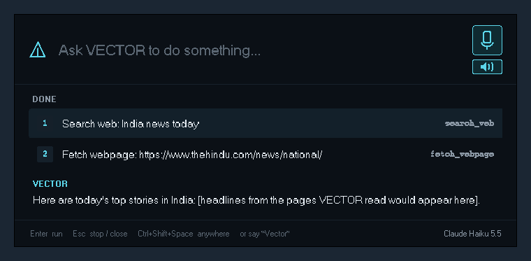
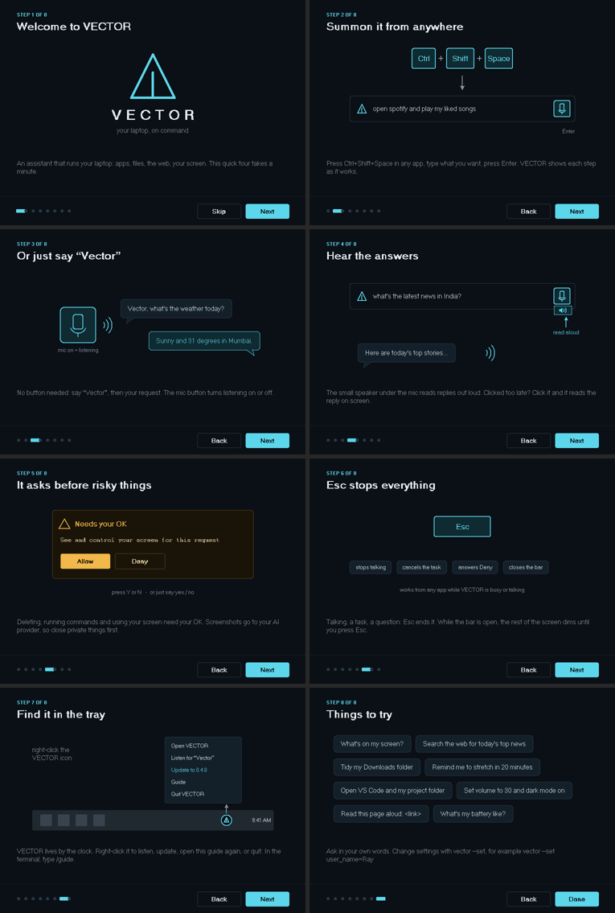
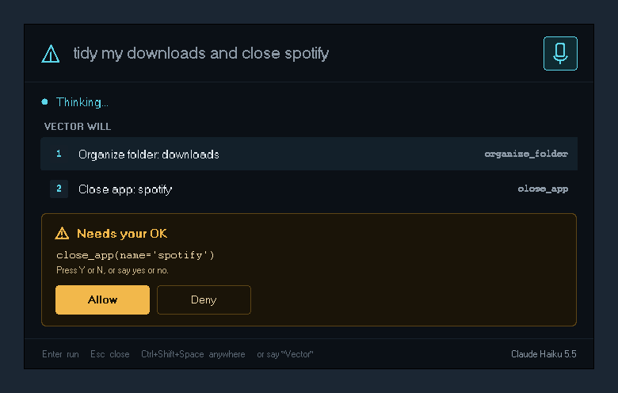

<div align="center">


**An open-source AI assistant that runs your laptop.**

Type or say what you want ("open Spotify", "tidy my Downloads", "what's on my screen?",
"search the web for today's news") and VECTOR works out the steps and does them.

Windows 10 / 11 &nbsp;·&nbsp; macOS 11+ &nbsp;·&nbsp; Claude, free cloud AI or fully local AI &nbsp;·&nbsp; MIT licensed

</div>

> **Pre-release (beta):** VECTOR is still being tested, so you might run into bugs or rough
> edges. If something breaks, please [open an issue](https://github.com/ReyhaanSJ/Vector/issues)
> with what you did and a screenshot. Running `vector --selftest` and pasting its report helps a lot.

> **New in 0.4.1: VECTOR for Mac.** Everything works on macOS too (Apple silicon and Intel).
> It's brand new, so Mac bug reports are extra welcome. See [Mac: one command](#mac-one-command).

> **Language:** VECTOR is **English only** for now. That covers the app, the guide, voice
> commands and speech recognition (the wake word and speech models are English). You can type
> to the AI in other languages and it may answer, but voice and everything else expect English.

<p align="center"></p>

---

## Contents

1. [What VECTOR can do](#1-what-vector-can-do)
2. [What you need](#2-what-you-need)
3. [Install](#3-install)
4. [Choose VECTOR's AI brain](#4-choose-vectors-ai-brain)
5. [First steps](#5-first-steps)
6. [Using VECTOR](#6-using-vector)
7. [Everything VECTOR can do (all skills)](#7-everything-vector-can-do-all-skills)
8. [Things to try](#8-things-to-try)
9. [Settings](#9-settings)
10. [Updating](#10-updating)
11. [Uninstalling](#11-uninstalling)
12. [Privacy and safety](#12-privacy-and-safety)
13. [Troubleshooting](#13-troubleshooting)
14. [How it works](#14-how-it-works)
15. [For developers](#15-for-developers)
16. [Roadmap, contributing and license](#16-roadmap-contributing-and-license)

---

## 1. What VECTOR can do

| | |
|---|---|
| **Summon it anywhere** | Press **Ctrl+Shift+Space** (Mac: **Control+Shift+Space**) in any app, type a request, press Enter. |
| **Talk to it** | Just say **"Vector, …"**. No button to press. It answers out loud. |
| **Hear answers** | A small speaker button reads replies aloud, even typed ones. |
| **Run your laptop** | Open and close apps, files and folders, volume, brightness, dark mode, Wi-Fi, reminders, clipboard and more (43 skills). |
| **See and use your screen** | Reads what's on screen, then clicks, scrolls and types like you would (asks first). |
| **Use the internet** | Searches the web and reads pages itself; downloads files when asked. |
| **Remember you** | "Remember my project folder is D:\robot" and it'll know next time. |
| **Stay safe** | Risky actions show **Allow / Deny** first. **Esc** stops anything instantly. |
| **Keep itself updated** | New versions are offered from the tray icon (Mac: the menu bar). |
| **Your choice of AI** | Claude (best), free cloud models, or a free AI that runs entirely on your laptop. |

## 2. What you need

| | Minimum | Notes |
|---|---|---|
| **Computer** | Windows 10 or 11, or a Mac with macOS 11 Big Sur or newer | Apple silicon and Intel Macs both work. Linux works from source, with fewer features (see [For developers](#15-for-developers)). |
| **Internet** | For setup, and for Claude / cloud AI | The local AI works offline after setup. |
| **Disk space** | ~1 GB | Plus ~2–9 GB if you choose the local AI (the model download). |
| **Memory** | 8 GB RAM | 16 GB+ for the local AI. An NVIDIA graphics card (or an Apple silicon Mac) makes the local AI much faster. |
| **Microphone** | Optional | Only needed for voice. |
| **Python, Git** | Not needed | Setup brings everything it needs. |

## 3. Install

### Windows: two clicks

1. Download **`VECTOR-Setup-<version>.zip`** from the [Releases page](https://github.com/ReyhaanSJ/Vector/releases).
2. Right-click the ZIP → **Extract All** → **Extract**.
3. Open the folder and double-click **`Install VECTOR.bat`**.
   If Windows says *"Windows protected your PC"*, click **More info → Run anyway**.
   (This appears for any downloaded script.)
4. Answer the questions. **Pressing Enter picks the suggested answer** every time.

Or paste this into PowerShell instead of steps 1–3:

```powershell
irm https://raw.githubusercontent.com/ReyhaanSJ/Vector/HEAD/install.ps1 | iex
```

**What setup does** (and skips if it's already there):

| Step | What happens |
|---|---|
| 1. Get VECTOR | Copies VECTOR to `%LOCALAPPDATA%\Programs\VECTOR`. You can delete the downloaded folder afterwards. |
| 2. Python | Reuses a Python 3.11–3.13 you already have, or downloads a private Python 3.13 just for VECTOR. Your own Python is never changed. |
| 3. Packages | Installs VECTOR, voice support and the offline speech models (~200 MB). |
| 4. AI brain | Asks which AI to use (next section) and sets it up, including installing Ollama for the free local AI. |
| 5. Shortcuts | Adds **VECTOR** to the Desktop and Start Menu, lists it in **Settings → Apps**, and (if you agree) starts it when you log in. |

### Mac: one command

1. Open **Terminal** (press **Cmd + Space**, type `Terminal`, press Enter).
2. Paste this and press Enter:

   ```bash
   curl -fsSL https://raw.githubusercontent.com/ReyhaanSJ/Vector/HEAD/install.sh | bash
   ```

3. Answer the questions (**Enter picks the suggested answer**). VECTOR appears in your
   **Applications** folder; open it with Spotlight (**Cmd + Space**, "VECTOR").

Or download **`VECTOR-Setup-<version>.zip`** from the [Releases page](https://github.com/ReyhaanSJ/Vector/releases),
open it and double-click **`Install VECTOR.command`** (if macOS blocks it: right-click → **Open** → **Open**).

The Mac setup does the same five steps: VECTOR goes to `~/Library/Application Support/VECTOR` with
its own private Python, API keys are kept in your **Keychain**, and the free local AI picks a model
for your Mac's memory. macOS asks once for the **Microphone**, **Screen Recording** and
**Accessibility** when VECTOR first needs them. All the Mac details: **[docs/macos.md](docs/macos.md)**.

## 4. Choose VECTOR's AI brain

Setup asks this, and you can change it any time.

| | **Free local AI** (Ollama) | **Free cloud AI** (OpenRouter) | **Claude** (Anthropic) |
|---|---|---|---|
| Cost | Free | Free (daily limits) | Paid, pay-as-you-go |
| Account / key | None | Free account + key | Anthropic API key |
| Privacy | Everything stays on your laptop | Requests go to OpenRouter and the model's provider | Requests go to Anthropic |
| Smarts | Good for simple tasks | Better | Best, especially for multi-step tasks |
| Can see your screen | Only with a vision model | Depends on the model | Yes |
| Works offline | Yes | No | No |

**Setting it up yourself:**

- **Free local AI:** setup installs [Ollama](https://ollama.com) and picks a model that suits your
  graphics card (`qwen2.5:7b` with 6 GB+ of graphics memory, otherwise `llama3.2`). On a Mac:
  `qwen2.5:7b` on Apple silicon with 16 GB+ of memory, otherwise `llama3.2`.
- **Free cloud AI:** sign up at [openrouter.ai](https://openrouter.ai), make a key at
  [openrouter.ai/keys](https://openrouter.ai/keys), and paste it when setup asks. VECTOR picks the
  best free model available automatically (`model = "auto:free"`) and switches if one is busy.
- **Claude:** create a key at [console.anthropic.com](https://console.anthropic.com) (API Keys), add
  some credit, and paste it when setup asks. Setting a monthly spend limit in the Console is a good idea.
  A Claude.ai subscription does not include API credit.

**Switching later** (in PowerShell, or Terminal on a Mac):

```powershell
vector --models                                   # what you can use right now
vector --set provider=ollama                      # free local AI
vector --set provider=openrouter                  # free cloud AI
vector --set provider=anthropic                   # Claude
vector --set model=claude-haiku-5-5               # a specific model (Claude Haiku = cheapest Claude)
setx OPENROUTER_API_KEY "sk-or-..."               # or ANTHROPIC_API_KEY "sk-ant-..."
```

On a Mac, save a key in the Keychain instead of `setx` (or just run the install command again):

```bash
security add-generic-password -U -s VECTOR -a ANTHROPIC_API_KEY -w "sk-ant-..."
```

Restart VECTOR after changing settings (tray icon → Quit, or **Cmd+Q** on a Mac, then open it again).

## 5. First steps

1. **The guide.** The first time VECTOR starts, an illustrated guide walks you through everything.
   See it again any time by typing **`/guide`** in the bar.

   

2. **The tray icon.** VECTOR lives by the clock (click **^** if you can't see it). Right-click it for
   the menu. On a Mac, VECTOR is in the **Dock** and its menu is in the **menu bar**.
3. **Your first request.** Press **Ctrl+Shift+Space**, type `what's my battery like?`, press Enter.
4. **Your first voice command.** Say *"Vector, what time is it?"* The first time voice starts it
   may take a minute to load.
5. **Check everything works** (optional). Open PowerShell (Mac: Terminal) and run `vector --selftest`.

## 6. Using VECTOR

### 6.1 The summon bar

| Part | What it does |
|---|---|
| **Input** | Type a request in your own words, press **Enter**. |
| **Mic button** | Turns listening for "Vector" on/off (cyan = listening). |
| **Speaker button** (small, under the mic) | Reads replies aloud. Turning it on also reads the reply already on screen. |
| **VECTOR WILL / DONE** | The steps VECTOR takes, numbered, with the skill it used on the right. |
| **Reply** | VECTOR's answer. |
| **Footer** | Shortcuts, and the AI model in use (bottom right). |

**Focus mode:** while you have the bar open, the rest of the screen dims and can't be clicked
until you press **Esc** (or the shortcut again). It lifts while VECTOR uses the screen, and doesn't
appear for quiet pop-ups. Turn it off with `vector --set focus_mode=false`.

### 6.2 Voice

- Say **"Vector"** followed by your request: *"Vector, open Spotify and play my liked songs"*.
- Say just **"Vector"** and it answers *"Yes?"*. Then say your request.
- When it asks permission, say **"yes"** or **"no"**.
- Listening for "Vector" happens **offline on your laptop**, and so does turning your speech into
  text. Nothing is sent anywhere until you've said "Vector" and your request.
- Turn listening off with the mic button, or from the tray icon.
- English only for now. "Victor" and "Vektor" are also accepted, because speech recognisers often hear those.

### 6.3 Read aloud

Click the small speaker button under the mic:
- **before asking:** every reply is read out loud, typed ones too;
- **after a reply is showing:** that reply is read now, and later ones too;
- **again:** read-aloud turns off and any reading stops. VECTOR remembers your choice.

### 6.4 Your screen

Ask things like *"what's on my screen?"*, *"click Reply"*, *"scroll down and summarise this page"*.
VECTOR takes a screenshot, works out where to click, acts, then checks with another screenshot.

- It asks **once per request**: *"See and control your screen for this request?"*
- Its own bar hides while it works, so it doesn't click on itself.
- **Esc** stops it, or move the mouse into a **corner of the screen**.
- Needs an AI that understands pictures (Claude does).

### 6.5 The internet

*"Search the web for…"*, *"what's the latest on…"*, *"read this page: <link>"*: VECTOR searches
(DuckDuckGo, then Bing as a backup) and reads the pages itself, and tells you where the information
came from. Downloads ask first.

### 6.6 Permissions and stopping

- **Needs your OK:** deleting, moving and writing files, running commands, closing apps, shutting
  down, downloading, and using the screen. Click **Allow** / **Deny**, press **Y** / **N**, or say yes / no.

  

- **Esc stops everything:** it stops talking, cancels the task (no further steps run), answers
  Deny to a pending question, and closes the bar. It works from any app while VECTOR is busy or talking.

### 6.7 Bar commands

| Type in the bar | What it does |
|---|---|
| `/guide` | Opens the illustrated guide |
| `/help` | Lists these commands |
| `/skills` | Lists everything VECTOR can do |
| `/model` | Shows which AI is answering |
| `/aloud` | Read replies out loud on/off (same as the speaker button) |
| `/reset` | Starts a fresh conversation (VECTOR's memory of you is kept) |
| `/uninstall` | Removes VECTOR. It asks whether to keep your data. |
| `/quit` (or `/exit`) | Closes VECTOR completely, including the tray icon |

### 6.8 The tray menu (Mac: the menu bar and Dock)

Right-click the VECTOR icon by the clock: **Open VECTOR**, **Listen for "Vector"**, **Update to x.y.z**
(when there is one), **Check for updates**, **Guide**, **Quit VECTOR**.

On a Mac there's no tray: click VECTOR in the **Dock** to open the bar, and use the **VECTOR** menu
at the top left of the screen (while VECTOR is the active app) for the same items. **Cmd+Q** quits.

## 7. Everything VECTOR can do (all skills)

You don't need to know these names: just ask in your own words. **⚠ = asks first**, **🖥 = uses
the screen (asks once per request)**.

| Area | Skills |
|---|---|
| **Apps & web** | open any app (including Microsoft Store apps) · close an app ⚠ · list running apps · open a website · open a search in your browser |
| **Internet** | search the web and read results · read any web page · download a file ⚠ |
| **Files** | list a folder · find files · open a file or folder · read a text file · create a folder · write a file ⚠ · move / rename ⚠ · delete ⚠ · tidy a folder into Images/Documents/… ⚠ |
| **Screen** | look at the screen 🖥 · click 🖥 · move the mouse 🖥 · scroll 🖥 · drag 🖥 · type text 🖥 · keyboard shortcuts 🖥 |
| **System** | battery / CPU / memory / disk · time and date · volume · lock screen · screenshot · shut down / restart / sleep ⚠ · run a command ⚠ (PowerShell on Windows, the shell on a Mac) |
| **Windows only** | dark/light mode · screen brightness · open any Settings page · Wi-Fi status · show desktop · empty Recycle Bin ⚠ |
| **Mac only** | dark/light mode · open any System Settings page · Wi-Fi status · Wi-Fi on/off ⚠ · show desktop · empty the Bin ⚠ |
| **Productivity** | reminders · notifications · read / write the clipboard · remember / recall / forget facts about you · media play/pause/next |

## 8. Things to try

- *"What's my battery like?"*
- *"Open VS Code and my robotics folder"*
- *"Tidy my Downloads folder, but show me what you'd do first"*
- *"Remind me to stretch in 20 minutes"*
- *"Set the volume to 30 and turn on dark mode"*
- *"What's on my screen?"* · *"Read me this error message"*
- *"Search the web for today's top news in India"* (with read-aloud on)
- *"Find the PDF I downloaded yesterday and open it"*
- *"Remember that my favourite editor is VS Code"*
- *"Open notepad and type a shopping list: milk, eggs, bread"*

## 9. Settings

Change any setting with **`vector --set name=value`** in PowerShell (Mac: Terminal), then restart VECTOR.
They're saved in `C:\Users\<you>\.vector\config.toml` (Mac: `~/.vector/config.toml`).

| Setting | Default | What it does |
|---|---|---|
| `user_name` | `Boss` | What VECTOR calls you |
| `provider` | `auto` | `ollama`, `openrouter`, `anthropic`, or `auto` (Claude if its key is set, else OpenRouter, else Ollama) |
| `model` | *(default)* | The AI model, e.g. `claude-haiku-5-5`, `qwen2.5:7b`, `auto:free` |
| `effort` | `low` | Claude only: how hard it thinks (`low` … `max`) |
| `confirm_dangerous` | `true` | Ask before risky actions. Strongly recommended. |
| `screen_access` | `ask` | `ask` (once per request), `always`, or `never` |
| `hotkey` | `ctrl+shift+space` | The summon shortcut, e.g. `ctrl+alt+v` |
| `focus_mode` | `true` | Dim and block the screen while the bar is open |
| `wake_word` | `vector` | The word that starts voice commands |
| `listen_on_start` | `true` | Listen for the wake word as soon as VECTOR opens |
| `speak_replies` | `true` | Speak replies to voice commands |
| `read_aloud` | `false` | Read typed replies aloud too (the speaker button) |
| `whisper_model` | `base.en` | Speech-to-text model: `tiny.en` (fastest), `base.en`, `small.en` (most accurate) |
| `check_updates` | `true` | Check for new versions once a day |
| `ollama_url` | `http://localhost:11434` | Where Ollama runs |
| `skill_dirs` | `[]` | Extra folders with your own skills |

## 10. Updating

VECTOR checks once a day. When there's a new version, right-click the tray icon → **Update to x.y.z**
(Mac: the VECTOR menu in the menu bar → **Update to x.y.z**).
It downloads, installs and reopens itself, keeping your settings and memory.

```powershell
vector --update            # install the newest version now
vector --versions          # list every version
vector --update 0.3.1      # install a specific version (also to go back)
```

## 11. Uninstalling

Type **`/uninstall`** in the summon bar, or use **Settings → Apps → VECTOR → Uninstall**, or run
`vector --uninstall`. On a Mac, use `/uninstall` or `vector --uninstall` (dragging the app to the Bin
leaves VECTOR's Python and login item behind).

1. VECTOR asks **"Uninstall VECTOR?"**
2. Then **"Keep your data?"** Your data is your settings and VECTOR's memory of you. Keep it and a
   reinstall remembers you; delete it for a clean slate.

**Esc at any point cancels**, and never deletes anything. Your AI keys are left in place in case
other apps use them, and Ollama is a separate app (remove it in Settings → Apps if you don't need it).
On a Mac, deleting your data also removes VECTOR's keys from the Keychain.

## 12. Privacy and safety

**What leaves your laptop:**

| | Local AI (Ollama) | Free cloud AI / Claude |
|---|---|---|
| Your requests | Stay on your laptop | Sent to the AI provider |
| What skills return (file names, text VECTOR reads, web results) | Stay on your laptop | Sent to the AI provider |
| **Screenshots** (only when it uses the screen, after you allow it) | Stay on your laptop | Sent to the AI provider |
| Voice: wake word and speech-to-text | Offline, on your laptop | Offline, on your laptop |

**Stored on your laptop:** settings and memory in `C:\Users\<you>\.vector\`; VECTOR itself in
`%LOCALAPPDATA%\Programs\VECTOR`; API keys as Windows user settings (environment variables).
On a Mac: settings and memory in `~/.vector/`, VECTOR in `~/Library/Application Support/VECTOR`, and
API keys in your login **Keychain**.

**Good habits:**
- Keep `confirm_dangerous = true`. Running with `--yes` skips confirmations; only do that if you trust the request.
- Close private things (passwords, private chats) before asking VECTOR to look at the screen, or set `screen_access = never`.
- Never share your API keys. Set a spend limit for Claude in the Anthropic Console.
- Only add skills (custom `.py` files) you've read. They run with your permissions.

## 13. Troubleshooting

Start with **`vector --selftest`**. It checks everything and explains what's wrong. The app's log is
at `C:\Users\<you>\.vector\app.log` (Mac: `~/.vector/app.log`). Mac problems (permissions,
shortcut, screen) are covered in [docs/macos.md](docs/macos.md#troubleshooting).

| Problem | Fix |
|---|---|
| "Windows protected your PC" when installing | Click **More info → Run anyway**. |
| `vector` is not recognized | Open a new PowerShell window. |
| The shortcut does nothing | Another app uses it: `vector --set hotkey=ctrl+alt+v`, then restart VECTOR. |
| VECTOR can't hear you | Settings → Privacy & security → Microphone → turn on **Let desktop apps access your microphone**; check the right mic is the default. |
| It reacts when nobody said "Vector" | Lower background noise, or turn listening off from the mic button. |
| "Can't reach the free local AI" | Start the **Ollama** app from the Start Menu. |
| "Ollama doesn't have 'model'" | Run `ollama pull <model name>` with the name it shows. |
| "The free model is busy" / "daily limit" | Free cloud models are shared. Wait, or switch: `vector --set provider=ollama`. |
| "Claude needs an API key" / "rejected the API key" | Run `vector --set-key claude` (or `vector --set-key openrouter`) and paste the key. It's checked first, then saved. Restart VECTOR. |
| Clicks land in the wrong place | Tell us your display scaling (Settings → Display) in an issue. |
| Blank or old icon | Restart the laptop to refresh Windows' icon cache; re-pin if you'd pinned VECTOR. |
| Voice failed to install | Run setup again (it uses its own Python 3.13 for voice). |

## 14. How it works

```
  you (type or speak) ──► VECTOR app ──► AI brain (Claude / OpenRouter / Ollama)
                              ▲                │  decides which skills to use
                              │                ▼
                         results ◄── skills ──► your laptop, the web, the screen
                                       (Allow / Deny first for risky ones · Esc stops)
```

1. You type in the bar, or say "Vector, …". An offline wake-word model listens for "Vector",
   then offline Whisper turns your speech into text.
2. VECTOR sends your request, plus a description of its skills, to the AI brain you chose.
3. The AI replies with steps ("open_app spotify", "search_web …"). VECTOR runs each skill, asking you
   first when it's risky, and sends back the results.
4. That repeats until the AI has an answer, which VECTOR shows (and reads aloud if you asked).

| Part | File |
|---|---|
| App: tray, shortcut, voice loop | `vector/app.py` |
| Summon bar | `vector/ui.py` |
| Guide | `vector/guide.py` |
| Safety checks, running skills | `vector/agent.py` |
| AI brains | `vector/brain/` (`claude.py`, `openai_compat.py`, `ollama.py`) |
| Skills | `vector/skills/` |
| Voice (wake word, speech-to-text, speaking) | `vector/voice.py` |
| Updates / uninstall | `vector/updater.py`, `vector/uninstall.py` |
| Windows setup / removal | `install.ps1`, `scripts/uninstall-windows.ps1` |
| Mac setup / removal | `install.sh`, `scripts/uninstall-macos.sh` |
| Mac pieces (shortcut, Keychain, menu name) | `vector/macos.py` |

## 15. For developers

**Run from source** (Windows, macOS or Linux; Python 3.11+):

```bash
git clone https://github.com/ReyhaanSJ/Vector.git && cd Vector
python -m venv .venv && source .venv/bin/activate      # Windows: .venv\Scripts\activate
pip install -e ".[all,dev]"
vector --app        # the app        ·   vector   # chat in the terminal (advanced)
pytest              # tests          ·   ruff check .
```

On Linux, voice needs PortAudio (`sudo apt install portaudio19-dev`). On a Mac, use a Python with
Tk (python.org or uv; Homebrew's needs `brew install python-tk`). Linux is typing-first: no installer,
and the Windows-only skills don't load.

**Add a skill:** drop a `.py` file in `C:\Users\<you>\.vector\skills\`:

```python
from vector import tool

@tool
def open_my_project() -> str:
    """Open my main coding project in VS Code."""
    import subprocess
    subprocess.Popen(["code", r"D:\robot"])
    return "Project opened."
```

Restart VECTOR and say *"open my project"*. The docstring tells the AI what the skill does, and type
hints define its inputs. Use `@tool(dangerous=True)` for anything that changes or deletes things,
and `@tool(screen=True)` for screen control. More in [docs/skills.md](docs/skills.md) and
[examples/skills](examples/skills).

**Release a version:** bump the version in `pyproject.toml` and `vector/__init__.py`, then
GitHub → **Actions → Release → Run workflow**. CI tests every change on Windows, macOS and Linux,
including the real Windows and Mac installers, the summon bar on both, and speech recognition with
Windows' own voice.

## 16. Roadmap, contributing and license

**Roadmap:** full desktop window with a system HUD · more languages · calendar and email skills ·
scheduled routines ("every morning at 9, open my work apps").

**Contributing:** bug reports, ideas and pull requests are welcome. See [CONTRIBUTING.md](CONTRIBUTING.md).
More details: [docs/windows.md](docs/windows.md) · [docs/macos.md](docs/macos.md). Pre-launch checklist: [docs/TESTING.md](docs/TESTING.md).

**License:** [MIT](LICENSE). Free to use, change and share.
